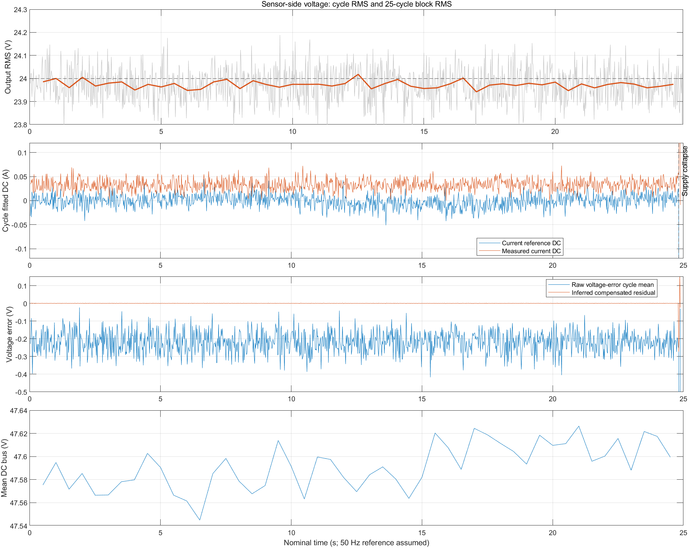

# 直流分量记录分析

数据：`D:/download/vofa/直流分量.csv`。使用 MATLAB R2023b 分析 49,802 点。按当前工程 20 kHz 控制、10 倍抽取估算记录约 24.90 s；CSV 无时间戳。以参考正弦过零位置划分完整周期，并拟合直流项、基波和二、三次谐波，减少非整数周期平均造成的假偏置。

用户说明：外部仪表读数曾出现 24.5 → 24.9 → 24.1 V；开头可能有少量开环，随后闭环。CSV 不含模式标志，无法准确确定切换点。以下数值描述正常供电的主要运行区段，不用于单独评价开闭环切换瞬态。

## 数据结果

正常区段取母线首次低于 40 V 之前、电压有效值大于 20 V 的完整周期，共 1,241 个。40 V 仅用于区分本次记录末尾的工况，不是新增固件保护阈值。

| 项目 | 正常供电区段结果 |
| --- | ---: |
| 参考电压基波有效值 | 23.9997 V |
| 采样电压有效值 | 23.9730 V |
| 采样电压单周期有效值范围 | 23.7279～24.1885 V |
| 每 25 周期（约 0.5 s）电压有效值范围 | 23.9419～24.0179 V |
| 电压反馈拟合直流项 | +0.21941 V |
| 电流参考拟合直流项均值 | −0.000367 A，即 −0.367 mA |
| 电流参考每 25 周期直流项范围 | −11.254～+7.871 mA |
| 实测电流反馈拟合直流项均值 | +32.844 mA |
| QPR 校正电压触及 ±5 V 限幅的比例 | 0% |
| 桥臂指令电压/母线电压的最大绝对值 | 0.7514 |

## 直流补偿的含义

当前实际运算先计算电压误差，再减去 `voltage_error_dc_v`，之后通过虚拟阻抗生成电流参考。CH3 输出的是这个电流参考；源代码“补偿前原始电流参考”的注释不能代表实际执行顺序。CH5 实际输出参考电压加限幅后的 QPR 校正电压，因此分析中的校正电压采用 CH5−CH1。

电流参考长期均值接近零，未发现明显持续下偏。从这一结果看，数据支持电压误差直流偏置的消除正在起作用。由于 CSV 未记录 `voltage_error_dc_v`，这属于从参考电流推断的结果，不能直接确认补偿状态的每个瞬时值。

该算法消除的是反馈电压误差的平均偏置，使虚拟阻抗不把采样偏置放大成直流电流参考。若实际使用的电压互感器不能传递直流，算法也无法由其反馈测出真实输出直流，更不能据此证明真实直流已被消除。反馈中的 +0.219 V 不能等同于输出端真实直流。

电流反馈的 +32.8 mA 可能来自真实直流，也可能来自电流传感器及模拟采样链路的零点。此前对模拟输入施加相同电压的校准未必包含完整电流传感器的零点，需用完整采样链在实际零电流下复核。

## Kp 与外部仪表读数

当前源码 Kp=1、Kr=10、直流偏置跟踪时间参数 0.2 s。Kp 位于内层电流 QPR，不是直接作用于电压有效值的比例参数。比例项影响环路带宽和稳定性，谐振项提供目标频率附近的增益；不能仅凭外部有效值波动确定 Kp 太小。

正常区段采样有效值维持在约 24 V，未出现外部仪表所示的约 0.8 V 变化。优先同步核对外部仪表读数、VOFA 有效值、输出端直流分量、采样增益和仪表测量模式。如果反馈增益变化，闭环仍可能把“测得的电压”维持在 24 V，而真实输出发生变化。本记录不能区分采样增益变化、真实直流分量、负载变化及仪表读数差异等原因。

比例/谐振参数作用参考：[Imperix PR controller](https://imperix.com/doc/implementation/proportional-resonant-controller)。

## 记录末尾另一个工况

第 49,650 点开始母线低于 40 V，之后下降到约 3.5～5 V；采样交流电压接近零，电流参考增大到数十安乃至接近百安，校正电压触及 ±5 V。它不属于正常供电下的稳态偏置，应单独检查供电退出时的控制状态和积分状态，不宜用全记录均值判断正常运行的参考电流下偏。

## 建议的验证顺序

1. 完整电流传感器及采样链供电、真实电流为零时复核电流零点。
2. 正常闭环时，用可测直流的仪表或直流耦合差分测量检查输出端平均电压；同时记录外部交流有效值与 VOFA 有效值。外部交流仪表若排除直流，其交流读数与直流分量不是同一指标。
3. 如需继续定位，增加记录电压误差直流估计量、补偿后的电压误差和控制模式，与已有通道同步。只有确认测量链与工况后，才比较不同 Kp 的闭环响应。

本次只生成分析文件，未修改固件。

