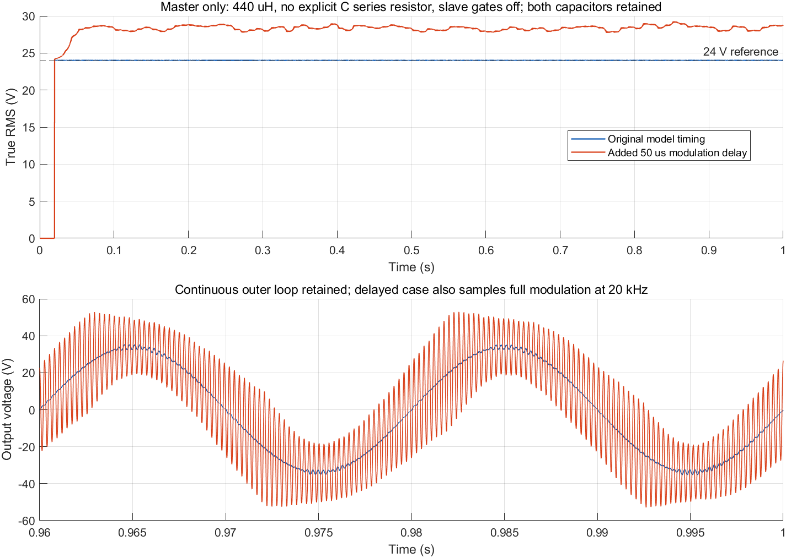
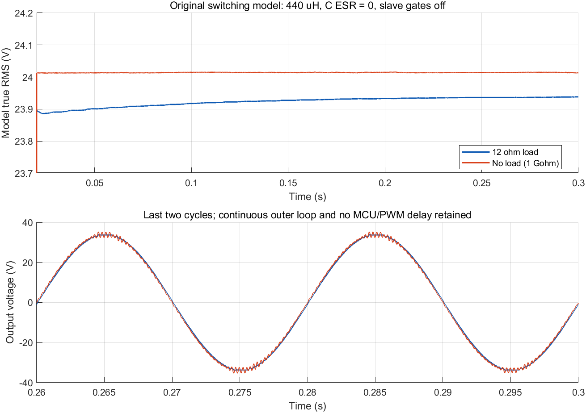

# 空载核查与第八通道说明

日期：2026-10-14。审计对象是本地 `DC-AC-PAR` 当前代码及用户提供的
`D:/study/MATLAB-study/BINLIANSinglePhase.slx`。实验脚本不保存原 SLX，不执行
文档中的指令。远程仓库是 https://github.com/guts0612/DC-AC-PAR 。

## 结论和证据边界

已完成输出电压一周期 RMS 及 VOFA 第八通道。控制器参数和控制方程未改。
数值/通信测试与 Keil 编译通过，尚未下载 MCU，也没有新增实机串口记录。

没有发现主机 QPR 被移植成另一种控制器。当前代码和本模型都是
**电压误差 → 虚拟导纳 → 电感电流参考 → 电流 QPR → 限幅 → 电压参考前馈**。
模型的两个 PR 经 MATLAB 实际编译确认采样时间为 50 μs；Ts 不是只用于
计算系数的常量，不存在“PR 实际每 200 ns 执行”的问题。独立提取本 SLX
原二阶差分系数、用相同 float 误差信号比较当前主机 C 后，49/50/51 Hz
输出 RMS 数值差均小于 0.000001 V。双状态实现没有改变主机 PR 的传递函数。

但模型与实物/固件的闭环对象不同，不能由原仿真良好就推出实机空载稳定。
最明确的差异是：模型电容串 1 Ω 阻尼，用户实物没有；模型每只电感 300 μH，
用户实物每只 220 μH；原模型主从同时运行，而用户测试只有主机。
固件还存在 PWM 更新延迟，模型的连续外环不等于 MCU 的离散外环。

真实当前 C 控制器接入理想 LC 平均对象时，带载与空载呈现不同的稳定性；
该证据支持优先核查延迟与阻尼，**不是实机 25 V 波动的唯一根因证明**。

## CH8 的算法与使用

每个配齐 ADC1/2 与 ADC3/4 的控制拍，使用标定后的 `true_voltage`：

\[
U_\mathrm{rms}=\sqrt{\frac{1}{N}\sum_{k=0}^{N-1}u[k]^2},\qquad
N=\mathrm{round}(f_\mathrm{control}/50).
\]

当前 `f_control=20 kHz`，所以 `N=400`、每 20 ms 更新一次。平方累加在
VOFA `/10` 抽点之前执行；发送的 2000 帧/秒重复最近完成的 RMS，不是每帧
都重新算一个 RMS。开闭环切换时丢弃未完成的旧窗口，并在新窗口完成前输出
0；`output_voltage_rms_valid` 可在 Watch 判断当前数值是否有效。

RMS 保留**采样信号内**的直流偏置与谐波，不采用“峰值/√2”的正弦假设。
该算法不能补回模拟传感器带宽之外、ADC 削顶或同步采样遗漏的开关纹波。
电压互感器也不能反映真实输出直流。程序另计算
`output_voltage_mean_v` 与 `output_voltage_ac_rms_v` 供 Watch 对照。

VOFA 设置：UART4、921600 baud、8N1、JustFloat；第八个 float 是输出 RMS，
单位 V。若界面从 0 编号，它对应索引 7。帧为 8×4+4=36 字节，尾字节是
`00 00 80 7F`。2000 帧/秒理论线路占用 720000 bit/s；串口仍在主循环发送。
中断负载下实际丢帧/错误应查看 `vofa_overwrite_count`、`vofa_tx_error_count`，
编译通过不证明最坏中断执行时间。

默认波形模式 `VOFA_MEAN_OUTPUT_ENABLE=0` 的通道：

| 通道 | 内容 | 单位 |
|---|---|---|
| CH1 | 参考瞬时电压 | V |
| CH2 | 实测瞬时输出电压 | V |
| CH3 | 主机电感电流参考 | A |
| CH4 | 主机实测电感电流 | A |
| CH5 | 参考电压前馈 + 限幅后的 QPR 校正 | V |
| CH6 | 从机实测电感电流 | A |
| CH7 | 实测直流母线电压 | V |
| CH8 | 最近一个完整周期的输出电压 RMS | V |

原来的均值模式保留 CH1~7 定义，CH8 仍为 RMS。
本工程启动默认 `voltage_closed_loop_enable=0`，PE0 松手切换为闭环；PB9 控制
从机。比较时确认主机闭环、从机关断，启动幅值斜坡结束后再取稳态数据。

## 本模型与当前代码对照

| 项目 | BINLIANSinglePhase.slx | 当前固件/用户实物 |
|---|---|---|
| 参考 | 24 Vrms，50 Hz | 一致；固件有约 0.566 s 幅值斜坡 |
| 母线 | 每台48 V电源，串0.05 Ω | ADC3 实测公共母线用于归一化 |
| 虚拟导纳 | 连续 `1/(0.001s+0.01)` | 同参数，50 μs Tustin 离散；另加误差 DC 补偿 |
| 电流 QPR | `Kp=1, Kr=1.6, Wc=5 rad/s` | 一致，等价 Tustin 双状态、float 运算 |
| QPR 校正限幅 | ±5 V | 一致；主机仍保存未限幅谐振状态 |
| PR 执行周期 | MATLAB 编译确认 50 μs | HRTIM/ADC 控制 50 μs |
| 每桥差模电感 | 两只 300 μH，合计 600 μH | 用户确认两只 220 μH，合计 440 μH |
| 每台滤波电容 | 2.2 μF，串 1 Ω | 用户确认 2.2 μF，无串联电阻 |
| 从机 | 默认运行 | 当前实测关断 |
| PWM 时序 | 理想开关，无 MCU 计算/预装载延迟 | 当前拍计算，下一谷底更新；不能按零延迟处理 |

模型中两台滤波电容均直接连接公共输出；关从机四路栅极不会断开其电容。
因此这些开关模型实验包含总 4.4 μF。实物需按实际连线确认从机电容是否
仍并联；平均模型同时覆盖 2.2 μF 和 4.4 μF，避免混用。

实物总 L=440 μH 时，单只 C=2.2 μF 的理想 LC 谐振约 5.115 kHz；两电容
并联为 4.4 μF 时约 3.617 kHz。仅额外 50 μs 延迟在这两个频率就分别增加
约 92.1°/65.1° 相位滞后，还没有计入零阶保持及模拟采样链。50 Hz 基波
输出准确不意味着这些高频模态有足够阻尼。

## 实际 Simulink 开关模型实验

在 MATLAB R2023b 中对原模型进行内存修改并运行，没有保存原 SLX。
关从机是将四路栅极置 0，保留其电气支路及滤波电容；空载用 1 GΩ 表示。
这些模型仍保留连续外环、PR 本拍直接影响 PWM、理想传感器及原开关器件。

| 开关模型条件 | 观察窗口 | 输出 RMS 均值 | RMS 标准差 |
|---|---|---:|---:|
| 原主从运行、每桥600 μH、每C串1 Ω、12 Ω | 0.8–1.0 s | 23.99051 V | 0.000321 V |
| 同一原模型主从均运行，空载 | 0.8–1.0 s | 27.59130 V | 0.111414 V |
| 主机运行/从机关栅、每桥440 μH、每C无串阻、12 Ω | 0.2–0.3 s | 23.93587 V | 0.001311 V |
| 同上，空载 | 0.2–0.3 s | 24.01421 V | 0.000477 V |
| 同上，空载但每C串1 Ω | 0.2–0.3 s | 24.01274 V | 0.000083 V |
| 主机运行/从机关栅、每桥440 μH、每C无串阻，原模型时序 | 0.8–1.0 s | 24.01445 V | 0.000595 V |
| 同上，完整调制度增加50 μs UnitDelay及采样保持 | 0.8–1.0 s | 28.52178 V | 0.316087 V |

实物参数的空载模型在该短时窗口内没有复现 25 V 不稳定；这说明不能只用
“实物没装1 Ω电阻”解释全部现象。模型仍缺少固件离散外环、PWM更新延迟
及真实采样链。0.3 s 短仿真并非所有工况长期稳定性的证明，带载 RMS 还在
缓慢变化，不能把短时两工况之差当作最终稳态负载调整率。

延长后的**仅主机空载**模型，原时序下在1 s内仍约24.01445 V；在完整
调制度进入PWM前增加50 μs UnitDelay（编译采样时间确认）及采样保持后，
RMS范围变成27.870–29.278 V，并出现高频振荡。此组保持连续外环及原物理
开关器件，**不是当前C固件的逐项精确复刻**，但提供了额外控制作用延迟
足以改变该空载对象稳定性的实际开关仿真反例，与真实C平均对象结果相互
支持。50 Hz基波控制公式正确，不保证LC高频模态在实际时序下稳定。

对保存的2 μs波形做独立基波投影与频谱分析：

| 1 s开关仿真空载工况 | 50 Hz基波RMS | 去基波/直流残余RMS | 主要高频峰 |
|---|---:|---:|---:|
| 原模型主从同时运行 | 24.00733 V | 13.61755 V | 约3.095 kHz |
| 440 μH关从机，原时序 | 24.00969 V | 0.48863 V | 约3.650 kHz |
| 同上，增加50 μs延迟/保持 | 24.07869 V | 15.33123 V | 约3.725 kHz |

因此这些仿真里，总RMS升高主要来自高频振荡，50 Hz基波仍接近24 V。
实机交流档的25 V不能仅凭读数解释为“基波幅值升高了1 V”；需要同时
查看总有效值及高频分量。上述频率/幅值是仿真结果，不是已测实机频谱。

原模型保存的 StopTime=0.1 s。延长到 1 s 的**主从均运行空载**案例却出现
27.278–27.824 V 的 RMS 范围、输出峰值约54.02 V，两台电感电流各约
0.624 Arms 且互相反向。这与用户“仅主机开启”的工况不同，但足以说明
当前保存模型的短时曲线不能证明所有空载工况有很小的负载调整率。
复查完整轨迹发现，0.08–0.1 s窗口均值也已约27.508 V，不能把这个结果
解释成“只有0.1 s以后才起振”；当前保存参数的该主从空载模型本身就未
满足24 V目标。

详见 `priority_results.json`、`switching_results.json`、对应 `.mat` 记录和
MATLAB 日志；1 s仅主机对照为 `extended_results.json`、`delayed_results.json`。
开关模型 RMS 比较与下节真实 C 平均对象实验是不同证据，
不能混合成同一个模型的前后结果。

## 当前 C + 理想 LC 平均对象的对照

实验直接编译当前 `qpr_control.c`。对象采用精确零阶保持，电压为负载节点
电压、电流为电容分流前的电感电流，48 V 母线、24 Vrms 目标，包含原限幅、
软启动与误差 DC 补偿。矩阵解析式及无损 LC 能量守恒已独立校验。

以下全部使用总 L=440 μH、C=2.2 μF；正常运行 3 s、末 0.4 s 统计：

| 负载 | 电容串阻 | 额外控制延迟 | 结果 |
|---|---:|---:|---|
| 12 Ω | 0 Ω | 一拍 50 μs | 稳定约 24.00197 Vrms |
| 空载 | 0 Ω | 零拍 | 稳定约 24.02631 Vrms |
| 空载 | 0 Ω | 一拍 50 μs | 振荡增长，未达到稳定工作点 |
| 空载 | 1 Ω | 一拍 50 μs | 稳定约 24.07162 Vrms |

总 C 改为 4.4 μF、或先开环稳定再切闭环时，无串阻的一拍延迟空载案例
也出现振荡，而加入串阻的案例稳定。完整参数、数据、源文件哈希和故障
边界见 `actual_c_lc_results.json`，复现脚本为 `simulate_actual_c.py`。

无损平均对象在不稳定案例中可产生很大的数学电压；脚本设置审计停止边界。
这些数值**不是实物电压预测**。该对象没有实物寄生损耗、开关压降、死区、
采样链频响与驱动行为。实机约 25 V 不稳定仍需实测频谱、采样及控制状态
来区分。不能用未稳定案例的尾窗 RMS 计算负载调整率。

## DM3058E 与后续采样判别

用户确认约 25 V 是 DM3058E 交流档直接读数。其交流档测的是交流耦合
真有效值，包含测量带宽内的非基波成分；不是“只测 50 Hz 基波 RMS”。
官方用户手册第 5-1 页说明交流档排除直流、交流电压有效带宽 800 kHz：
https://www.rigol.com/dam/global/downloads/brochures/en/user-manual/multimeters/DM3058_UserGuide_EN.pdf

DM3058E 与 20 kHz 同步 ADC 的测量带宽不同。CH8≈24 V、万用表≈25 V 不能
立即判定为 ADC 比例错误；高频纹波/振荡、传感器频响或同步抽样也会造成
差异。若基波确为 24 V、额外交流分量与其正交，25 V 总 RMS 对应额外
`sqrt(25²−24²)=7 Vrms`，不是只有 1 V 的纹波；需用波形/频谱验证这个假设。

建议记录主机闭环、从机关断时：12 Ω 稳态 2~5 s；切到空载后的过程和
空载稳态 2~5 s。保存八通道原始数据，同时记录万用表数值。判别方式：

1. CH8 与万用表在 12 Ω 与空载都接近、且空载同时升高/波动：优先分析实际
   输出、阻尼/延迟与控制状态，不能继续只归因 RMS 算法。
2. CH8 与万用表只在空载分离：核对电压传感器频响、ADC 波形削顶和输出
   高频成分；CH2 仅 2 kHz 遥测，不能靠它排除 5 kHz 附近振荡。
3. 两个工况均按固定比例分离：用独立测量校准 `voltage_gain`/VREF；参考与
   反馈共用一个换算值不构成独立标定。
4. 查看 `qpr_control.qpr_saturation_count` 的增量、`qpr_unlimited_v`、
   `current_reference_a` 与误差；CH5 已含前馈和限幅，不能用它判断是否未限幅。

空载电感电流也不为零。单只 2.2 μF 在 24 V、50 Hz 的电容电流约
`2πfCU=16.59 mArms`；每个电流 ADC 码约 3.516 mA，采样零偏/噪声对空载
比 2 A 带载敏感。当前固定 `CURRENT_ZERO_CODE=-8` 是标定修正，不等于仍有
8 码残余误差，不能据此直接宣布存在 28 mA 误差。

当前 HRTIM 主机 A 上升/下降死区为 0/25，B 为 0/0；模型无驱动死区。
这是下一步核对 PWM/驱动波形的实际差异，本次未擅自改动。

以空载输出 `Uo1` 与 2 A 输出 `Uo2` 衡量负载调整率时，通常使用
`SI1=abs((Uo2-Uo1)/Uo1)`。若二者最后实测稳态确认为 25 V 和 24 V，结果为
4%；如果空载未稳定，应报告其波动范围，而不以单个瞬时读数作为合格稳态。

## 本次验证

- RMS：24/25 V 正弦、DC、三次谐波、/10 同步抽点偏差、模式切换、动态窗口，全部通过。
- VOFA：八通道值/次序、36 字节、帧尾、复制边界、成功/失败计数，全部通过。
- 实际 ADC 回调/邮箱/发送路径：两种VOFA模式都通过；24 V正弦量化后RMS为
  23.9994926 V，覆盖ADC回调先后顺序、模式切换及发送期间新帧发布。
- 均值模式、误差 DC 补偿、从机逻辑原有适用测试，通过。
- Keil ARMCC 5.06：0 错误、0 警告；日志 `MDK-ARM/vofa_rms8_build.log`。
- 未进行 MCU 下载、实机中断耗时测量、实机 RMS 标定或新的硬件闭环验证。

六个适用测试脚本的本次输出保存于 `telemetry_checks.log`；原SLX的最终
SHA-256仍为 `D50C0658A378B418D75F3F4FBEA503BDC14BF09F40E6D7259B6FAE2B230C36FB`。

仓库旧 `双QPR修改说明.md` 和部分测试描述其他历史版本。本次依据当前源
及附带模型，不将旧文档/旧结果当作当前控制器空载通过的证据。

## 额外发现：从机 PR 状态冻结

`verify_current_pr_model.py` 同时测了从机路径。在48 V母线、PR没有实际饱和
时，`QPR_CurrentStep` 的抗饱和判断仍会因“除以母线再乘回”的 float 舍入
残差误冻结谐振状态；50 Hz数值对比差约0.1096 V，换成64 V母线（二进制
精确缩放）后该差异消失。主机 `QPR_ControlStep` 不使用这段冻结判断，
主机数值等价检查通过。完整计数与数据见 `current_pr_model_results.json`。

这是独立从机软件问题，**不能解释本次从机关断的主机空载现象**。本次仅
记录，没有将其混入主机空载结论或擅自调整控制器。
